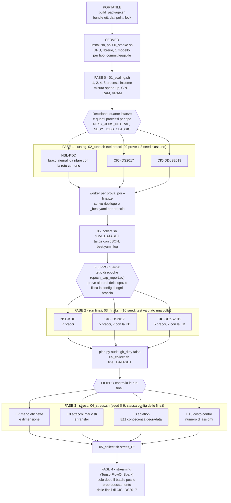

# Workflow sul server

Noi prepariamo il pacchetto, il correlatore lo lancia, noi riceviamo le cartelle dei risultati. Nessun accesso SSH.
Gli script stanno in `server/` e leggono il piano da `server/plan.yaml`. Questo file dice cosa si lancia, in che ordine, cosa deve uscire e cosa gira in parallelo.
I conteggi sono run da fare, non ore: le ore si ricavano dal test di scaling (fase 0), non da stime.

## 1. Diagramma

Le tre colonne di ogni fase sono indipendenti tra loro. Le frecce tra le fasi sono dipendenze vere.

## 2. Fasi, run, script, output

| Fase | Script | Run previste | Input | Output atteso |
|---|---|---|---|---|
| install | `install.sh` | - | `repo.bundle`, `data_interim.tar`, `requirements.lock` | `~/nesy-nids-bench` con checkout pulito, `.venv`, `data/interim/*.parquet` |
| smoke | `00_smoke.sh` | 6 (1 per tipo, seed 0, solo validation) | config `nslkdd_*` | 6 JSON in `results/server/smoke/`, ultima riga `smoke OK`; ogni JSON con `git_commit` diverso da `unknown` e `git_dirty: false` |
| scaling | `01_scaling.sh` | 4 config x (1+2+4+8) processi | `configs/measure_cicids2017_*.yaml` | `results/server/scaling/<config>/summary.tsv` con P, tempo di parete, speed-up, tempo di `fit`, epoche, RAM, core, GPU |
| tuning | `02_tune.sh DS` | 360 per dataset (6 bracci x 20 prove x 3 seed) | `configs/tuning/DS_ARM.yaml` | per braccio: 60 file `tune_DS_ARM_tNN_seedS.json` (seed 100-102), 20 file `tune_DS_ARM_trialNN.json`, `tune_DS_ARM.json` (riepilogo), `tune_DS_ARM_best.yaml` |
| finali | `03_final.sh DS` | 10 per braccio: 70 su NSL-KDD, 50 sui CIC una volta scritti i config di tuning (70 con la KB) | `results/tuning/*_best.yaml` | per braccio 10 file `<run_id>_seed0..9.json` con `metrics.val`, `metrics.test`, `c5` dove c'è una KB, `git_dirty: false` |
| stress | `04_stress.sh E..` | vedi `plan.py table` (al massimo E7 900, E9 120, E3 40, E13 100; E11 da fissare) | `configs/stress/E*_*.yaml` (da scrivere) | come le finali, un `run_id` per livello |
| ritorno | `05_collect.sh NOME` | - | `results/` | `results/server/out/NOME_data.tar.gz` e `.sha256`, `MANIFEST.txt` (commit, macchina, run non citabili) |

NSL-KDD: RF e XGBoost hanno già il tuning (primo giro, non dipende dalla rete), ma i risultati stanno sul portatile. Restano da rifare 240 run (4 bracci neurali): `bash server/02_tune.sh nslkdd mlp_noweights mlp_weights ltn_sup ltn_full`. Senza i nomi dei bracci lo script fa tutti e sei, RF e XGBoost compresi (costano poco).

## 3. Cosa gira in parallelo

Fase 1, tuning
- Le 360 run di un dataset sono indipendenti: braccio, prova e seed non si parlano.
- I tre dataset sono indipendenti.
- Lo script divide le prove tra N worker (prova i va al worker i mod N). Il massimo per braccio è 20 worker. Per usare più istanze: una istanza per dataset, oppure una per braccio (`02_tune.sh DS ARM`).
- Si fa un solo passo in serie, in coda a ogni braccio: `--finalize`, che scrive riepilogo e `_best.yaml`.
- I bracci neurali condividono la GPU; RF e XGBoost sono su CPU. Neurale e classico possono girare insieme, a patto di non saturare la RAM.

Fase 2, finali
- Ogni seed di ogni braccio è indipendente (10 per braccio). Parte solo quando il braccio ha il suo `_best.yaml`.
- Lo script manda un processo per seed, fino a `NESY_JOBS_*`.

Fase 3, stress
- Ogni (esperimento, livello, braccio, seed) è indipendente. Parte dopo le finali del braccio, perché usa la sua config.
- E13 (costo) fa eccezione: misura tempi, quindi va a carico controllato, un processo alla volta, non in parallelo con altro.

Come si regola il parallelo: `NESY_JOBS_NEURAL=4 NESY_JOBS_CLASSIC=2 bash server/02_tune.sh cicids2017`. I valori giusti escono dalla fase 0. Valori massimi misurati sul portatile per processo (1 seed, non una previsione di come vanno insieme): rete neurale 3,9-6,8 GB di RAM e 1,9-2,3 GB di VRAM; RF e XGBoost circa 5 GB di RAM e nessuna GPU. Quanti core usino RF e XGBoost non è misurato: lo dice `01_scaling.sh` (colonna `cores`).

## 4. Misurato finora (portatile RTX 3050 4 GB, 1 seed, tempo di parete, non citabile)

| Run su CIC-IDS2017, tutto il train | Tempo |
|---|---|
| rete (MLP-CE) | 490 s, 528 s, 662 s |
| LTN-sup | 766 s |
| Random Forest | 337 s |
| XGBoost | 231 s |

CIC-DDoS2019: tuning non misurato. NSL-KDD: tempo di `fit` per seed nel tuning 26-112 s (rete), 40-210 s (LTN), 1-21 s (RF), 1-5 s (XGBoost). Le ore del piano precedente erano calcolate da questi numeri con il 30% di margine.

## 5. Cosa torna indietro

Dopo ogni fase il tar.gz di `05_collect.sh`: JSON delle run, `_best.yaml`, config finali (`results/final_configs/`), log e `failed.txt`. Il commit e la macchina stanno in `MANIFEST.txt`. Pesi dei modelli e dati non entrano. Per lo streaming servono i pesi e il preprocessamento delle finali di CIC-IDS2017: il runner oggi non li salva (TODO, fase 4).

## 6. Come si capisce se è andata bene

- Una riga di `results/server/progress.txt` per braccio: tuning `60/60`, finali `10/10`.
- `results/server/failed.txt` assente o vuoto. Se c'è, dice cosa e dove sta il log.
- `python server/plan.py audit` finisce con `0 run non citabili`.
- Un lavoro interrotto si rilancia identico: le run già finite non si rifanno e nessuna viene sovrascritta.

## 7. Cosa non è pronto

Stato esatto: `python server/plan.py table`. Oggi:
- Config di tuning dei CIC: non esistono. Vanno scritti per i sei bracci (spazi da NSL-KDD, con il sottocampione dei Normal su CIC-IDS2017 solo per il tuning, D1).
- KB per CIC-IDS2017 e CIC-DDoS2019: senza, `ltn_full` e `rule_only` non girano sui CIC.
- Rete comune ai bracci neurali (D6): `tune.py` e i config di tuning cercano ancora rete e batch per braccio.
- Config degli stress: `configs/stress/` non esiste. Mancano nel codice `kb.exclude`, `kb.perturbation`, lo split per giorni di CIC-IDS2017, le copie di un assioma, lo script di latenza.
- Salvataggio di pesi e preprocessamento per le finali di CIC-IDS2017.
- Ambiente: `install.sh` usa `requirements.lock` (TensorFlow 2.21). Se driver e CUDA del server non vanno, serve un'immagine o un altro lock.
- Limite fisso di VRAM per processo: oggi c'è solo `TF_FORCE_GPU_ALLOW_GROWTH`. Se nel test di scaling i processi si pestano, si aggiunge.

## 8. Da decidere prima di lanciare

1. Tetto di 50 epoche (`claude/coerenza_e_aperti.md` punto 21): `python analysis/epoch_cap_report.py` sul tuning di NSL-KDD dice quante prove lo toccano. Va deciso prima del tuning dei CIC.
2. D6 sui CIC: la rete comune vale anche lì. Si riusa quella scelta su NSL-KDD o se ne sceglie una per dataset?
3. Frazioni di E7 (3 o 5) e livelli di E11.
4. Istanze, durata e date: le dà il correlatore dopo la fase 0.

## 9. Run citabili senza checkout

Il pacchetto porta un bundle git: `install.sh` fa `git clone`, quindi `git_commit` e `git_dirty` sono veri. Gli script scrivono solo in `results/` e `data/interim/`, ignorate da git. `03_final.sh` e `04_stress.sh` si rifiutano di partire se `git status` non è vuoto. Alternativa, se non si vuole la storia nel pacchetto: file COMMIT letto da `results.py` (punto 22 di `coerenza_e_aperti.md`, decide Filippo).
